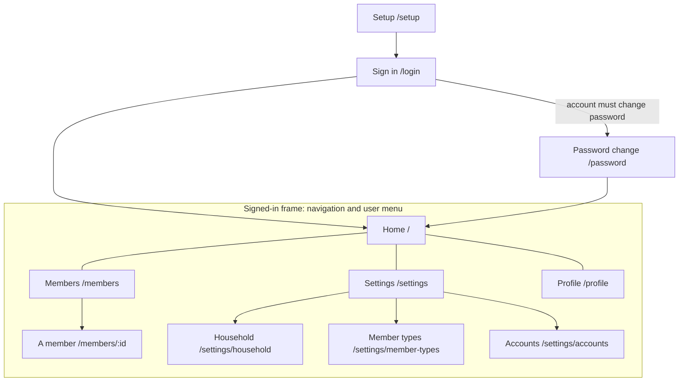

# Screens

Every screen of the app, its route (relative to the app), who reaches it and from where. The approved mockup of each one lives in `screens/<screen>/` (handoff format in [`README.md`](README.md)). Archiving a change updates this map.

## Map

Navigation shows Home to every signed-in user, and Members and Settings only to those the policy allows (`household.view`, `settings.view`). Profile and sign-out are in the user menu.

## Screens

| Screen | Route | Who | Reached from | Mockup |
|---|---|---|---|---|
| Setup | `/setup` | Anyone, only before the household exists | First start | Baseline: the shipped screen (v0.3.0) |
| Sign in | `/login` | Signed out | Any page when signed out | Baseline |
| Password change | `/password` | A user who must set a new password | Sign in, after a reset | Baseline |
| Home | `/` | Signed in | Navigation | Baseline |
| Members | `/members` | Users allowed to view the household; managing members is for administrators | Navigation | Baseline |
| A member | `/members/:id` | Users allowed to view the household; editing and account actions for administrators | Members | Baseline |
| Settings | `/settings` | Users allowed to view settings | Navigation | Baseline |
| Household | `/settings/household` | Administrators | Settings | Baseline |
| Member types | `/settings/member-types` | Administrators | Settings | Baseline |
| Accounts | `/settings/accounts` | Administrators | Settings | Baseline |
| Profile | `/profile` | Signed in | User menu | Baseline |
| Error | any | Anyone | A failed page | Baseline |
| Offline | any | Anyone, without connection | The service worker | Baseline |
| Component catalog | `/dev/components` | Development server only | Typed address | Not a product screen |

**Baseline:** these screens were built before ADR 0030, so there are no approved mockups yet; the shipped screen is the reference. Captures with fictitious data go into `screens/<screen>/` once the demo household exists. A change that modifies one of these screens adds its mockup through `ux.md`, and archiving puts it here.
