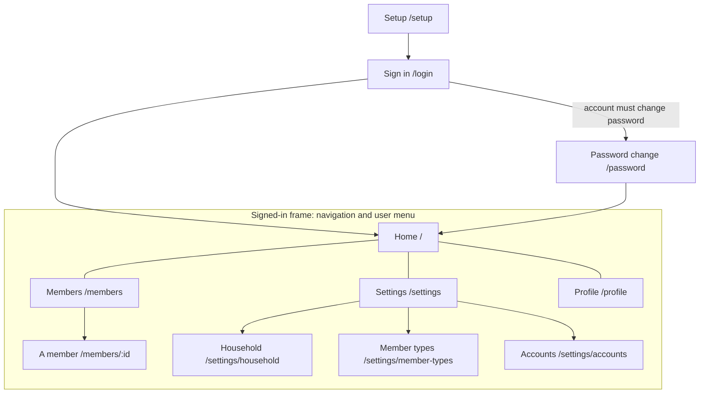

# Screens

Every screen of the app, its route (relative to the app), who reaches it and from where. The approved mockup of each one lives in `screens/<screen>/` (handoff format in [`README.md`](README.md)). Archiving a change updates this map.

## Map

Navigation shows Home to every signed-in user, and Members and Settings only to those the policy allows (`household.view`, `settings.view`). Profile and sign-out are in the user menu.

## Screens

| Screen | Route | Who | Reached from | Mockup |
|---|---|---|---|---|
| Setup | `/setup` | Anyone, only before the household exists | First start | [phone](screens/setup/phone.png), [desktop](screens/setup/desktop.png) (baseline) |
| Sign in | `/login` | Signed out | Any page when signed out | [phone](screens/sign-in/phone.png), [desktop](screens/sign-in/desktop.png) (baseline) |
| Password change | `/password` | A user who must set a new password | Sign in, after a reset | [phone](screens/password-change/phone.png), [desktop](screens/password-change/desktop.png) (baseline) |
| Home | `/` | Signed in | Navigation | [phone](screens/home/phone.png), [desktop](screens/home/desktop.png) (baseline) |
| Members | `/members` | Users allowed to view the household; managing members is for administrators | Navigation | [phone](screens/members/phone.png), [desktop](screens/members/desktop.png) (baseline) |
| A member | `/members/:id` | Users allowed to view the household; editing and account actions for administrators | Members | [phone](screens/member/phone.png), [desktop](screens/member/desktop.png) (baseline) |
| Settings | `/settings` | Users allowed to view settings | Navigation | [phone](screens/settings/phone.png), [desktop](screens/settings/desktop.png) (baseline) |
| Household | `/settings/household` | Administrators | Settings | [phone](screens/household/phone.png), [desktop](screens/household/desktop.png) (baseline) |
| Member types | `/settings/member-types` | Administrators | Settings | [phone](screens/member-types/phone.png), [desktop](screens/member-types/desktop.png) (baseline) |
| Accounts | `/settings/accounts` | Administrators | Settings | [phone](screens/accounts/phone.png), [desktop](screens/accounts/desktop.png) (baseline) |
| Profile | `/profile` | Signed in | User menu | [phone](screens/profile/phone.png), [desktop](screens/profile/desktop.png) (baseline) |
| Error | any | Anyone | A failed page | [phone](screens/error/phone.png), [desktop](screens/error/desktop.png) (baseline) |
| Offline | any | Anyone, without connection | The service worker | [phone](screens/offline/phone.png), [desktop](screens/offline/desktop.png) (baseline) |
| Component catalog | `/dev/components` | Development server only | Typed address | Not a product screen |

**Baseline:** these screens were built before ADR 0030, so they have no approved mockup; the reference is a capture of the shipped screen with the demo household (`npm run design:capture`, app v0.3.0). A change that modifies one of these screens adds its mockup through `ux.md`, and archiving puts it here in place of the capture.
