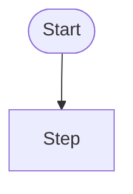

# UX

<!-- If the change adds or changes no screen, message or interaction: "No UI." and one line saying why. -->

## Screens

<!-- Each new or changed screen: route, where it is reached from, its place in docs/design/screens.md -->

## Flows

<!-- One Mermaid flowchart per multi-step flow -->

## Wireframes

<!-- Low-fidelity layout per screen, agreed before any mockup -->

## Mockups

<!-- One folder per screen: mockups/<screen>/ with export (.html, or .png/.webp) at phone and desktop width, states/, source.md -->

| Screen | Folder | Tool | Approved |
|---|---|---|---|

## States

<!-- Per screen: empty, loading, error, no permission, offline, long content (en-XA), right-to-left -->

| Screen | State | What is shown | Mockup |
|---|---|---|---|

## Components

<!-- Library components per screen; any new component and why the existing ones don't fit -->

## Conformance

<!-- Where a mockup departs from the tokens, components or patterns, and how it is resolved -->

## Texts

<!-- New interface texts in English, with plurals and arguments marked -->
